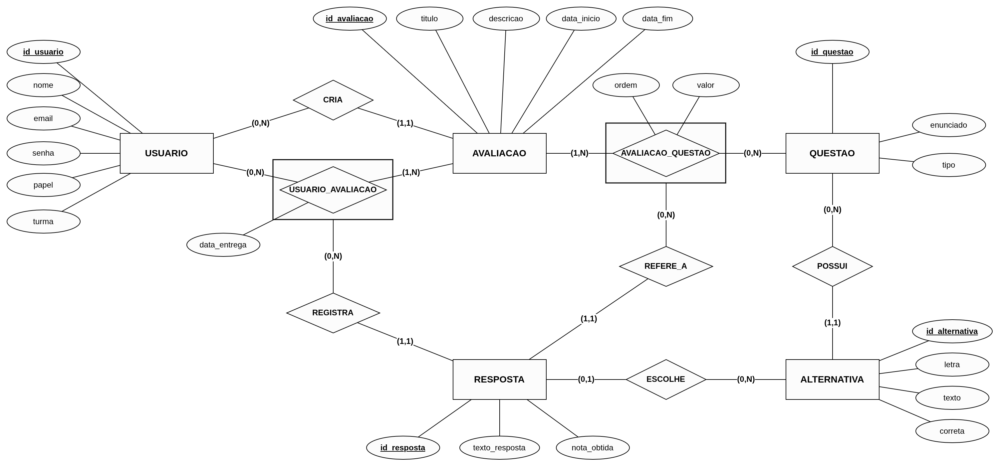
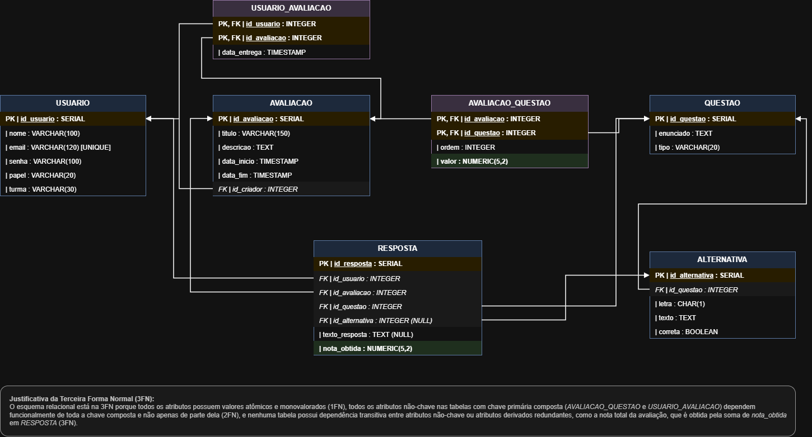
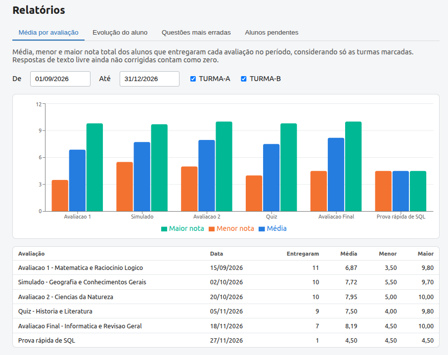
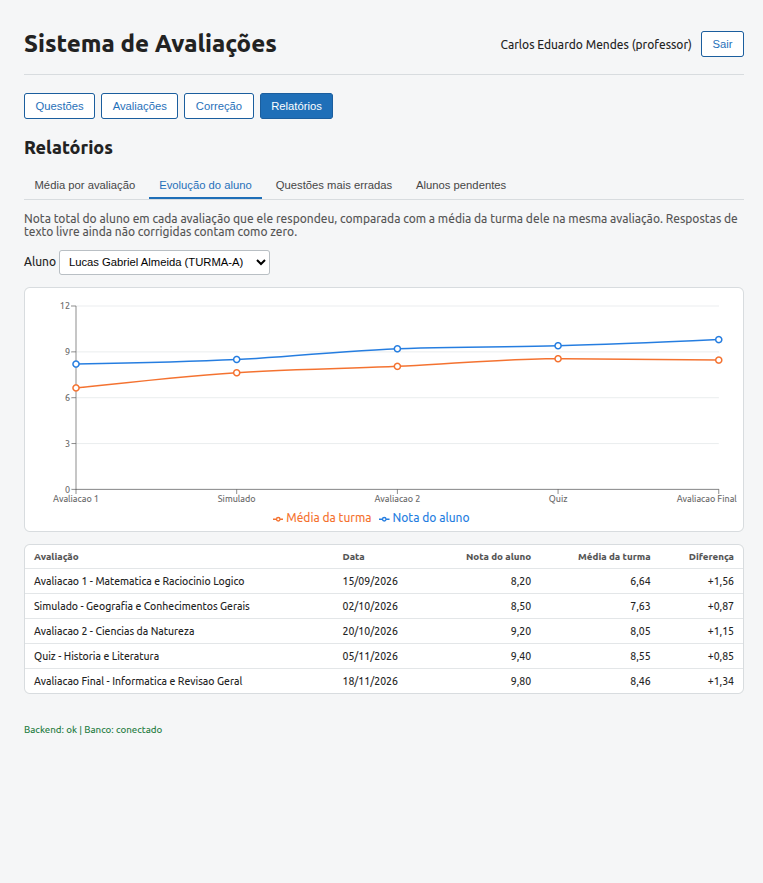
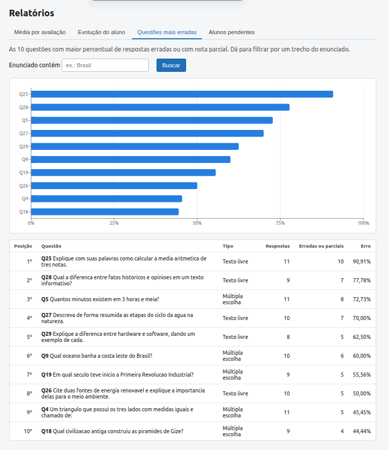
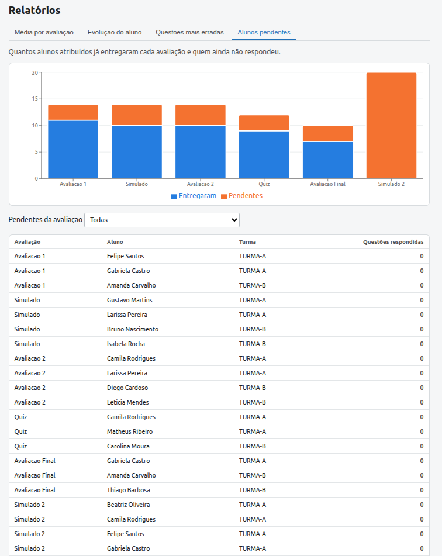

# Sistema de Avaliações - Banco de Dados I

Trabalho da disciplina de Banco de Dados I (UEL) - Prof. Dr. Anderson Paulo Avila Santos.

## Integrantes
- Frederico Krett
- Ana Zarelli

## Natureza do Sistema
Escolhemos a natureza avaliação de aprendizagem (provas, simulados, quizzes).
Cada questão possui um valor definido na avaliação. O sistema registra a nota obtida em cada questão (calculada automaticamente nas questões objetivas e atribuída pelo professor nas questões de texto livre) e calcula a nota total de cada aluno.

## Modelagem

O DER está em `docs/DER.png` e o esquema relacional em `docs/esquema.png`.





O esquema está na 3FN. Todos os atributos são atômicos. Nas tabelas com chave composta os atributos dependem da chave inteira. Não tem dependência transitiva. A nota total do aluno não é guardada porque sai da soma de `nota_obtida` em `resposta`.

## Como rodar

Precisa de PostgreSQL, Java 21 e Node.js 20.19 ou mais novo.

1. Criar o banco e rodar os scripts na pasta do projeto.

```
createdb avaliacoes
psql -d avaliacoes -f database/schema.sql
psql -d avaliacoes -f database/carga.sql
```

2. Subir o backend. O usuário e a senha do banco vão por variável de ambiente.

```
cd backend
DB_USER=seu_usuario DB_PASSWORD=sua_senha ./mvnw spring-boot:run
```

Se o banco tiver outro nome use também `DB_URL=jdbc:postgresql://localhost:5432/nome_do_banco`. No Windows o comando é `mvnw.cmd` e as variáveis são definidas antes com `set` no CMD ou `$env:DB_USER="seu_usuario"; $env:DB_PASSWORD="sua_senha"` no PowerShell.

3. Em outro terminal subir o frontend.

```
cd frontend
npm install
npm run dev
```

4. Abrir http://localhost:5173 no navegador.

Para entrar como professor use `carlos.mendes@email.com` com a senha `prof123`. Para entrar como aluno use `beatriz.oliveira@email.com` com a senha `aluno123`. Todos os alunos da carga usam a senha `aluno123`.

## Relatórios

São 4 relatórios na tela Relatórios do professor. Cada um tem gráfico e tabela. As consultas estão em `database/relatorios.sql` com filtros fixos de exemplo. No sistema os filtros vêm da tela.

Resposta de texto livre sem correção conta como zero.

### 1. Média por avaliação

Média, menor e maior nota de cada avaliação entre os alunos que entregaram. Dá para filtrar por período e turma.



Usa JOIN, subconsulta, SUM, AVG, MIN, MAX, COUNT, GROUP BY, HAVING, BETWEEN e IN.

```sql
SELECT
    a.id_avaliacao,
    a.titulo,
    a.data_inicio,
    COUNT(DISTINCT ua.id_usuario) AS total_respondentes,
    ROUND(AVG(notas_aluno.nota_total), 2) AS media_notas,
    ROUND(MIN(notas_aluno.nota_total), 2) AS menor_nota,
    ROUND(MAX(notas_aluno.nota_total), 2) AS maior_nota
FROM avaliacao a
INNER JOIN usuario_avaliacao ua ON ua.id_avaliacao = a.id_avaliacao
INNER JOIN usuario u ON u.id_usuario = ua.id_usuario
INNER JOIN (
    SELECT
        r.id_usuario,
        r.id_avaliacao,
        SUM(COALESCE(r.nota_obtida, 0)) AS nota_total
    FROM resposta r
    GROUP BY r.id_usuario, r.id_avaliacao
) notas_aluno ON notas_aluno.id_usuario = ua.id_usuario
             AND notas_aluno.id_avaliacao = ua.id_avaliacao
WHERE ua.data_entrega IS NOT NULL
  AND a.data_inicio BETWEEN '2026-09-01 00:00:00' AND '2026-12-31 23:59:59'
  AND u.turma IN ('TURMA-A', 'TURMA-B')
GROUP BY a.id_avaliacao, a.titulo, a.data_inicio
HAVING COUNT(DISTINCT ua.id_usuario) >= 1
ORDER BY a.data_inicio ASC;
```

### 2. Evolução do aluno

Nota do aluno em cada avaliação comparada com a média da turma dele.



Usa JOIN, subconsulta correlacionada, SUM, AVG, GROUP BY e ORDER BY.

```sql
SELECT
    a.id_avaliacao,
    a.titulo,
    a.data_inicio,
    u.nome AS aluno,
    u.turma,
    ROUND(SUM(COALESCE(r.nota_obtida, 0)), 2) AS nota_aluno,
    ROUND((
        SELECT AVG(sub.nota_total)
        FROM (
            SELECT r2.id_usuario, SUM(COALESCE(r2.nota_obtida, 0)) AS nota_total
            FROM resposta r2
            INNER JOIN usuario u2 ON u2.id_usuario = r2.id_usuario
            WHERE r2.id_avaliacao = a.id_avaliacao
              AND u2.turma = u.turma
            GROUP BY r2.id_usuario
        ) sub
    ), 2) AS media_turma
FROM resposta r
INNER JOIN avaliacao a ON a.id_avaliacao = r.id_avaliacao
INNER JOIN usuario u ON u.id_usuario = r.id_usuario
WHERE u.id_usuario = 3
GROUP BY a.id_avaliacao, a.titulo, a.data_inicio, u.nome, u.turma
ORDER BY a.data_inicio ASC;
```

### 3. Questões mais erradas

As 10 questões com mais erros. Dá para filtrar por um trecho do enunciado.



Usa JOIN, COUNT, SUM, GROUP BY, HAVING, RANK(), ORDER BY, FETCH FIRST e LIKE.

```sql
SELECT
    RANK() OVER (ORDER BY
        ROUND(100.0 * SUM(CASE WHEN COALESCE(r.nota_obtida, 0) < aq.valor THEN 1 ELSE 0 END) / COUNT(*), 2) DESC,
        COUNT(*) DESC
    ) AS posicao,
    q.id_questao,
    q.enunciado,
    q.tipo,
    COUNT(*) AS total_respostas,
    SUM(CASE WHEN COALESCE(r.nota_obtida, 0) < aq.valor THEN 1 ELSE 0 END) AS total_erros_ou_parciais,
    ROUND(100.0 * SUM(CASE WHEN COALESCE(r.nota_obtida, 0) < aq.valor THEN 1 ELSE 0 END) / COUNT(*), 2) AS percentual_erro
FROM questao q
INNER JOIN avaliacao_questao aq ON aq.id_questao = q.id_questao
INNER JOIN resposta r ON r.id_avaliacao = aq.id_avaliacao AND r.id_questao = aq.id_questao
WHERE LOWER(q.enunciado) LIKE '%'
GROUP BY q.id_questao, q.enunciado, q.tipo
HAVING COUNT(*) >= 1
ORDER BY percentual_erro DESC, total_respostas DESC
FETCH FIRST 10 ROWS ONLY;
```

### 4. Alunos pendentes

Alunos que ainda não responderam cada avaliação e o total de entregas.



Usa LEFT JOIN, COUNT, GROUP BY e ORDER BY.

```sql
SELECT
    a.id_avaliacao,
    a.titulo,
    u.id_usuario,
    u.nome AS aluno,
    u.turma,
    CASE
        WHEN ua.data_entrega IS NULL THEN 'PENDENTE'
        ELSE 'ENTREGUE'
    END AS status_entrega,
    COUNT(r.id_resposta) AS questoes_respondidas
FROM usuario_avaliacao ua
INNER JOIN avaliacao a ON a.id_avaliacao = ua.id_avaliacao
INNER JOIN usuario u ON u.id_usuario = ua.id_usuario
LEFT JOIN resposta r ON r.id_usuario = ua.id_usuario AND r.id_avaliacao = ua.id_avaliacao
WHERE ua.data_entrega IS NULL
GROUP BY a.id_avaliacao, a.titulo, u.id_usuario, u.nome, u.turma, ua.data_entrega
ORDER BY a.id_avaliacao ASC, u.turma ASC, u.nome ASC;
```

```sql
SELECT
    a.id_avaliacao,
    a.titulo,
    COUNT(ua.id_usuario) AS total_atribuidos,
    COUNT(ua.data_entrega) AS total_entregues,
    COUNT(ua.id_usuario) - COUNT(ua.data_entrega) AS total_pendentes
FROM avaliacao a
LEFT JOIN usuario_avaliacao ua ON ua.id_avaliacao = a.id_avaliacao
GROUP BY a.id_avaliacao, a.titulo
ORDER BY a.data_inicio ASC;
```
